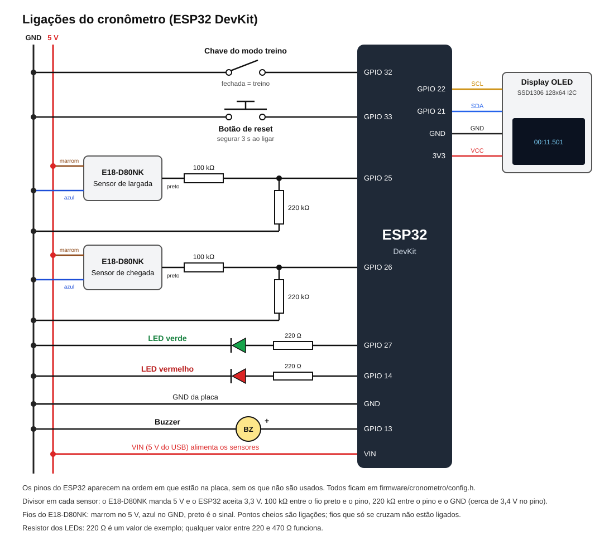

# Cronômetro para corrida de seguidor de linha

Este é o cronômetro que eu construí para as provas de robô seguidor de linha. Ele roda inteiro num ESP32: dois sensores marcam a largada e a chegada, um display mostra o tempo, e o juiz controla tudo pelo celular, numa página que o próprio cronômetro serve. Não precisa de computador, de internet nem de instalar aplicativo.

Ele já foi usado em competição de verdade, e boa parte do que está aqui nasceu de problemas que eu vi acontecer na pista.

## Por que eu fiz

A primeira versão dependia de um notebook rodando um servidor e de uma rede Wi-Fi funcionando no local da prova. Na prática isso quebrava justamente na hora que não podia: rede lotada, notebook sem bateria, gente tropeçando no cabo. Então resolvi colocar tudo dentro do ESP32. Ele cria a própria rede, guarda as competições na memória interna e não perde nada se cair a energia no meio da prova.

## O que ele faz

- Mede o tempo com precisão de milissegundos entre o sensor de largada e o de chegada.
- Cadastra equipes e robôs, inclusive importando uma planilha (CSV ou JSON).
- Organiza a competição em dias e tomadas e monta o ranking pelo melhor tempo válido.
- O juiz escolhe o robô, libera a corrida e depois valida, invalida ou manda repetir a tomada, tudo pelo celular. Dá para corrigir um resultado depois, se alguém errou o toque.
- Robô que não apareceu para largar é registrado como "não compareceu" com um toque, sem travar o fim do dia.
- Tem uma tela de **Painel** para deixar numa TV ou notebook mostrando o ranking para o público.
- O display mostra um QR code para entrar no Wi-Fi do cronômetro e, depois, outro para abrir a página. O juiz não precisa digitar endereço nenhum.
- Uma chave física troca para o **modo treino**: o robô passa pelos sensores e o tempo aparece no display, sem cadastro nenhum.
- Pode se conectar a uma rede com internet, incluindo redes de faculdade com usuário e senha (eduroam).
- Senha do juiz opcional: com ela ligada, o público consegue ver o ranking mas não consegue mexer em nada.

## Como é usar numa prova

1. Ligo o cronômetro. O display mostra o QR code do Wi-Fi dele.
2. Leio o QR com o celular, entro na rede e leio o segundo QR, que abre a página do juiz.
3. Crio a competição, escolho quantos dias e quantas tomadas por dia, e inscrevo os robôs.
4. Para cada corrida: escolho o robô, toco em **Liberar**, o robô passa pelos sensores e o tempo aparece no celular e no display. Toco em **Válida**, **Inválida** ou **Repetir tomada**.
5. No fim do dia, avanço para o próximo. No último, encerro a competição e o ranking final fica no histórico.

O passo a passo completo, do ponto de vista de quem está julgando, está em [docs/como-usar.md](docs/como-usar.md). Antes de levar uma versão nova para a pista, eu sigo o [roteiro de testes de bancada](docs/testes-de-bancada.md).

## Hardware

- ESP32 DevKit (o modelo comum, de 30 ou 38 pinos)
- 2 sensores infravermelhos E18-D80NK (largada e chegada)
- Display OLED SSD1306 de 128x64, I2C
- LED verde, LED vermelho e um buzzer
- Uma chave liga/desliga (modo treino) e um botão (reset da rede e da senha)



As ligações, os pinos e os cuidados com os sensores estão em [hardware/montagem.md](hardware/montagem.md).

## Como gravar no ESP32

1. Instale o **Arduino IDE** e, no gerenciador de placas, o pacote **esp32 da Espressif, versão 2.0.14**. Tem que ser essa versão: a conexão com redes de usuário e senha (eduroam) usa uma parte do sistema que mudou nas versões 3.x.
2. No gerenciador de bibliotecas, instale **Adafruit SSD1306**, **Adafruit GFX Library** e **ArduinoJson** (versão 7).
3. Abra `firmware/cronometro/cronometro.ino`, escolha a placa **ESP32 Dev Module** e grave. O esquema de partição padrão funciona.

Se você mexer na página do juiz (`firmware/cronometro/pagina/index.html`), rode antes de gravar:

```bash
python ferramentas/gerar_pagina.py
```

Isso compacta a página para dentro do firmware, que é o que deixa uma página desse tamanho caber no ESP32. No Windows também dá para dar dois cliques em `ferramentas/gerar_pagina.bat`. Precisa só do Python 3, sem instalar nada.

## Testes

As funções da página do juiz (busca, leitura de planilha, ranking, formato do tempo) têm testes que rodam no computador, sem o ESP32. Com o Node instalado, na pasta do projeto:

```bash
node --test
```

## Organização das pastas

```text
firmware/cronometro/   código do ESP32 (abra o cronometro.ino no Arduino IDE)
  pagina/              página do juiz, em HTML comum
ferramentas/           script que compacta a página para o firmware
hardware/              ligações e pinos
docs/                  como usar numa competição e o roteiro de testes de bancada
testes/                testes da página do juiz
```

Os pinos, limites (quantos robôs, competições etc.) e tempos ficam todos em `firmware/cronometro/config.h`.

## O que ainda quero fazer

- **Ranking online:** o cronômetro já sabe mandar os resultados para um servidor na internet, mas ainda não testei isso numa prova. Quando estiver confiável, o servidor entra aqui também.
- **ESP32-S3:** estou pensando em migrar para ter mais memória. Pelo que vi, só a pinagem muda.

## Licença

MIT. Pode usar, copiar e modificar à vontade, inclusive para a sua equipe ou competição. Só peço que mantenha o crédito. O texto completo está em [LICENSE](LICENSE).

Feito por Matheus Leineker Stanula, na UTFPR.
